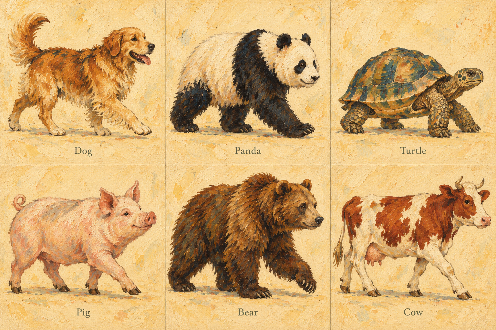
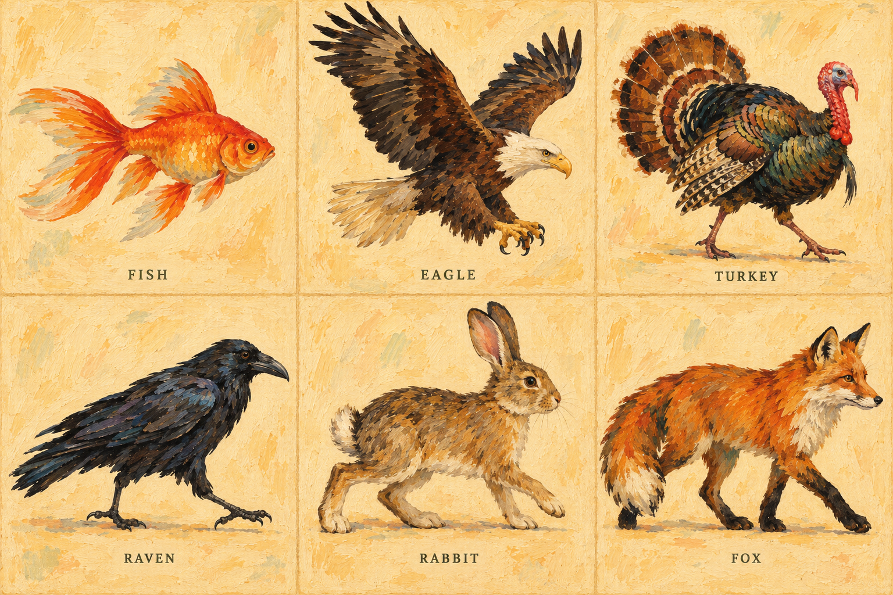
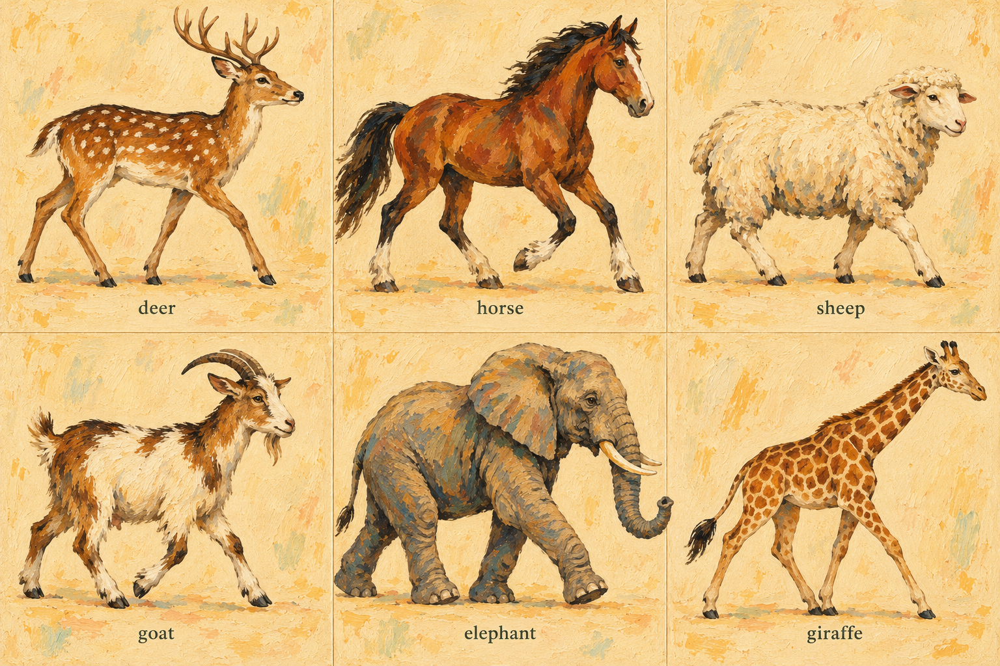
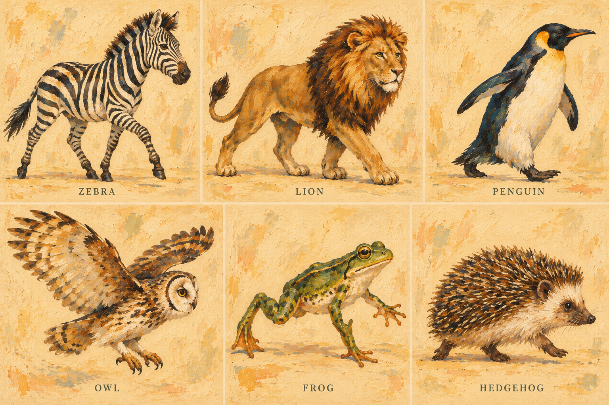

# Approved painted artwork

On October 25, 2026, the owner approved the painted cat/fish style and both clock material proofs, then approved the four sheets below before animation integration. The previous vector character direction is superseded.

The application now uses transparent painted raster artwork for all 25 species, a separate frosted-glass texture, perspective-projected solid blocks and sockets, and articulated raster motion. The approvals are recorded in the conversation. No further artwork approval is pending for this cast.

## Master style and clock treatments

- [Cat and red fish painting](docs/art-review-v2/painted-cat-and-fish.png)
- [Frosted-glass reference proof](docs/art-review-v2/frosted-glass-clock.png)
- [Digital depth reference proof](docs/art-review-v2/depth-clock.png)

The proofs establish style and materials; the functioning clocks are rendered separately so hands, segment depth, text, and timing can change accurately.

## Approved remaining character stills

## Production treatment

Transparent raster atlases retain the approved pigment and edges. A deformable mesh articulates limbs, body, tail, wings, and fish movement continuously while preserving the painting's identity. This avoids independently redrawing the character in every frame. Each species has been sampled through a 64-pose movement cycle in browser checks.

The analog clock has painted countdown hands, a small exact time readout, raster glass grain, depth-dependent blur, and contact-driven tail movement. The digital clock has recessed sockets and physical segment extrusion; incoming blocks move from behind the face, and outgoing blocks travel toward the viewer before falling. The runtime palette follows the approved artwork and the timer's phase colors.

[Production prompts](docs/painted-cast/PROMPTS.md) and [initial proof prompts](docs/art-review-v2/PROMPTS.md) document built-in image-generation usage.
