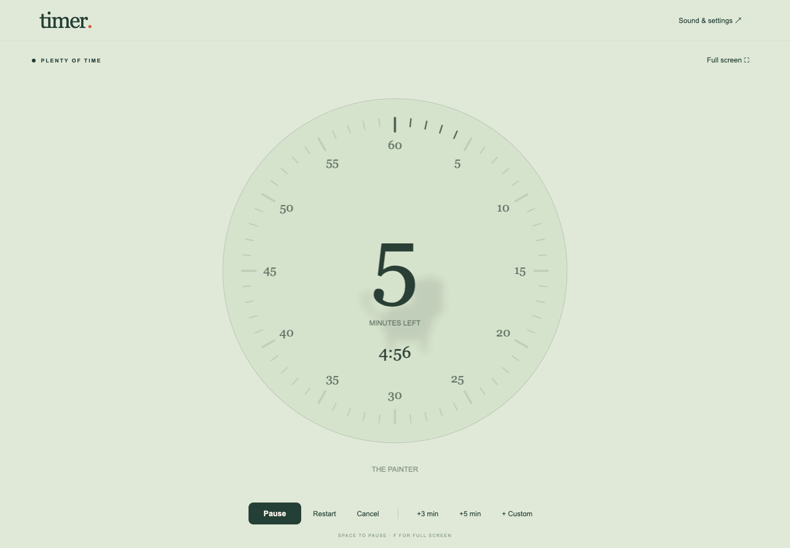
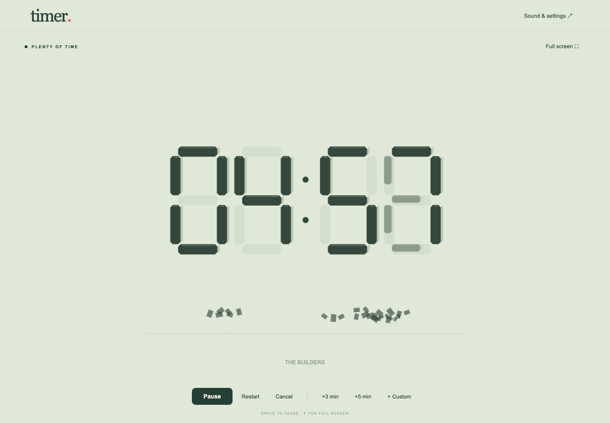

# Artwork approval — pending

The owner requested approval of one still frame of each artwork before producing further animation frames. Pause further artwork expansion, sprite generation, and animation production until that approval is recorded in the conversation.

The current implementation uses procedural vector artwork and interpolated motion. Existing motion studies are drafts; they do not establish approval of the character designs.

## Character stills

Each character appears once in this labeled sheet:

Approval can be given to the entire sheet or to individual characters. Changes to style should be applied to the still artwork and reviewed before more animation production.

Pending: cat with beret, dog, panda, turtle, pig, bear, cow, fish, eagle, turkey, raven, rabbit, fox, deer, horse, sheep, goat, elephant, giraffe, zebra, lion, penguin, owl, frog, hedgehog.

## Clock design stills

## Design criteria

A coherent Matisse-inspired palette and simple contours; immediately recognizable animals; expressive but restrained characters; consistent linework; a faint cat silhouette behind frosted glass; readable classroom clocks. Approval is for the visual design, before further animation production.
