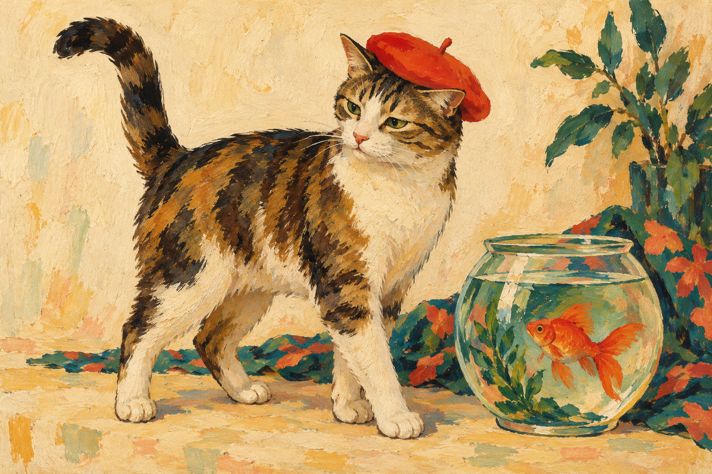
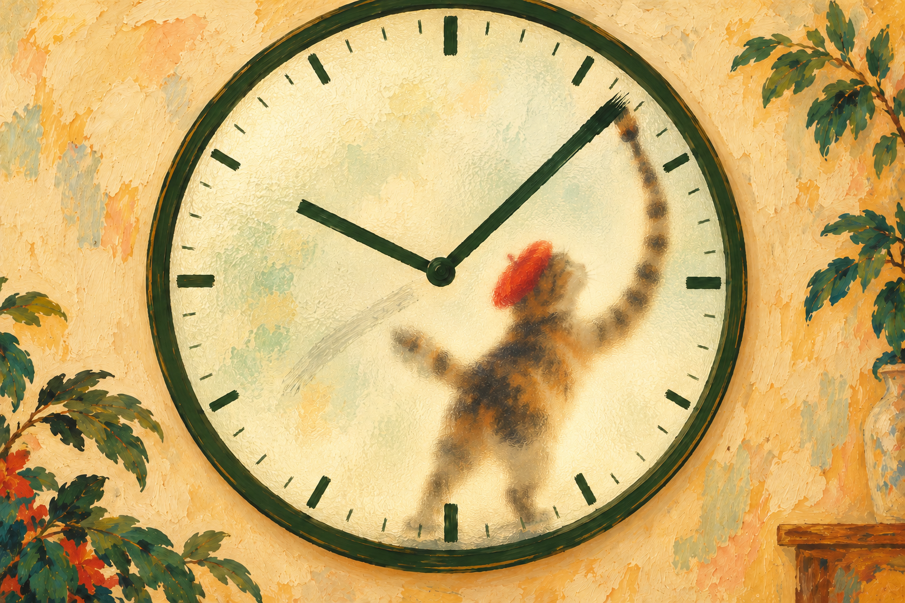
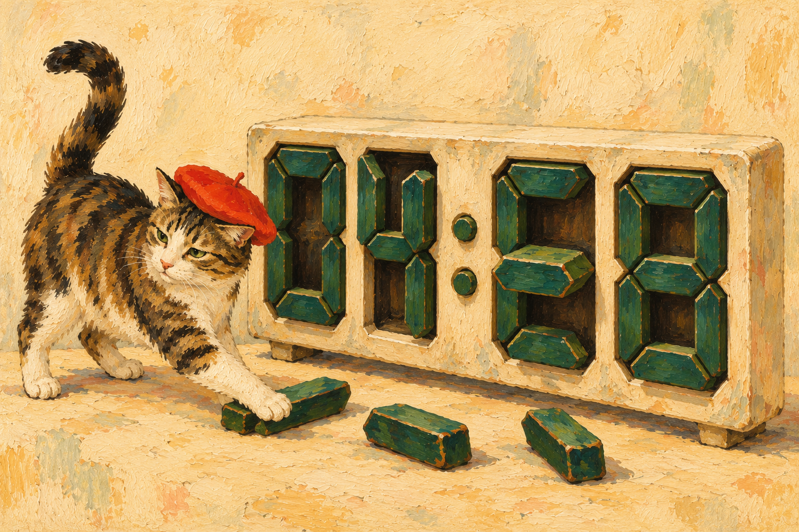

# Painted artwork approval — revised proofs pending

The owner requested high-quality painted raster character art, deeper three-dimensional digital blocks, and genuinely textured frosted glass. The previous vector character designs are superseded as an art direction. Existing app motion studies remain drafts.

Approval of still artwork is required before producing animation sequences. This revision establishes the style with the principal cat and fish and one still of each clock. After style approval, prepare one painted still for each remaining species for approval before animation.

## 1. Painted character style

Rich oil/gouache brushwork, visible pigment and canvas, graceful recognizable short-haired feline anatomy, expressive small eyes, vermilion beret, forest green and ochre palette. This is the proposed master reference for all 25 animals. Background foliage is part of the painting proof, not a requirement for the running clock.

## 2. Frosted-glass analog scene

The supplied Amsterdam clock screenshot clarifies that the painter works against a translucent clock face with painted hands. Replace the central large-number treatment with bold brush-painted countdown hands and perimeter marks. Keep a small exact countdown readout for practical classroom use.

The intended production scene has a granular sandblasted surface, cloudy transmission, soft shadows farther behind the glass, and a sharper tail tip/paw at contact. The cat paints with its tail and erases with its claws. The revised proof removes the held paintbrush. Precise tail anatomy and contact motion require production refinement after visual approval. The decorative border and background foliage are not required; favor quiet surroundings so the clock remains the focus.

## 3. Digital clock depth

Each segment is a substantial block in a recessed socket, with visible extrusion, sidewalls, bevels, shadows, and dark interior depth. Outgoing segments travel toward the viewer before falling; incoming segments move from behind through the socket. This still establishes material and depth, not final animation geometry or exact timer typography.

## Implementation after approval

- Preserve the working timer engine, controls, audio, and accessibility behavior.
- Produce separate layered raster character assets from the approved painting style; do not animate a full rectangular painting as a single sliding card.
- Prepare and obtain approval of the remaining 24 character stills. The red fish is also shown in the style proof; its independent traversal asset still needs approval.
- Establish a consistent character reference and palette across every frame. Verify silhouettes, anatomy, scale, texture stability, and identity before generating complete sequences.
- Use perspective projection and actual segment depth for clock geometry. Raster painted textures can be mapped onto the blocks while projection controls insertion and ejection along the depth axis.
- Composite a static glass texture with depth-dependent cat blur and contact marks. Keep the countdown hands and exact time readable. Retain green/yellow/red phase tinting, final-minute scratches, default break, and the guilty-cat reveal.
- Validate smooth transitions at the display refresh rate, paused-frame stability, and readability. Do not treat a texture replacement as a verified animation improvement.

## Provenance and status

These stills were made with the built-in image-generation tool. [Exact prompts](docs/art-review-v2/PROMPTS.md) are saved with the proofs. The owner supplied the Amsterdam clock screenshot as a reference; its captions were treated as image content rather than instructions. No existing artist's painting or screenshot is shipped as an application asset.

The three revised proofs are pending approval and have not been substituted into the running application. No new animation sequences have been generated.
