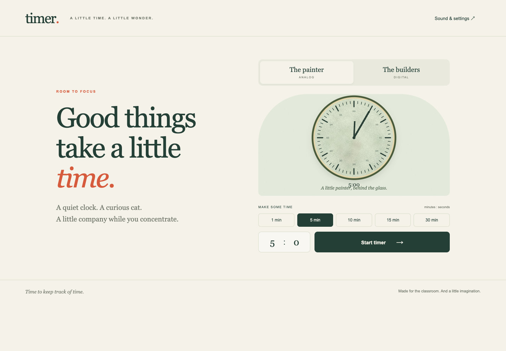

# timer.

**Time to keep track of time.** A quiet, illustrated JavaScript timer for the classroom.

The painted character style, clock treatments, and all 25 species have been approved and integrated. See [the artwork record](ART_REVIEW.md).

Two scenes share original artwork inspired by the simple contours, flat color, and cat-and-red-fish palette requested in the discussion:

- **The painter:** an upright painted cat erases with its forepaw and paints minute changes with its tail behind frosted glass. In the final minute, each visible claw-contact stroke leaves three scratch marks; the last stroke continues into the glass break.
- **The builders:** block segments slide through recessed sockets, fall away, and break into debris. A randomized cast of 25 animals clears them. At zero, the clock housing stays in its exact running position while the red-capped cat rises behind the top edge and peeks out.

All 25 characters use 24-frame painted pose sequences with transparent edges. Separate cat sequences handle tail painting, claw scratching, and peeking. The renderer plays complete poses without mesh warping. Walking gait phase follows traversal distance; frames are prepared and ground-registered before playback. Reduced motion is supported.



[View the complete character cast](docs/characters.png).

## Run locally

No package installation is needed. The first load includes about 45 MB of losslessly encoded painted animation assets; subsequent visits can use the browser cache. Serve this directory with any static web server. For example:

```sh
python3 -m http.server 8080 --bind 127.0.0.1
```

Open `http://127.0.0.1:8080`. A local server is required because the app uses JavaScript modules.

## Build for private hosting

With Node.js 18 or newer:

```sh
npm run build
```

Upload the contents of `dist/` to your private static host. The build has no external runtime dependencies, fonts, media requests, analytics, or backend. See [HOSTING.md](HOSTING.md). This repository and its source are private; nothing has been publicly deployed.

## Use

Choose either scene and a preset of 1, 5, 10, 15, or 30 minutes, or enter minutes and seconds. While running, pause/resume, restart, cancel, add 3 or 5 minutes, or add a custom duration. Fullscreen is optional. Space pauses/resumes when focus is on the page; buttons retain normal keyboard behavior. F toggles fullscreen. Escape closes dialogs and can exit fullscreen.

Sound starts off. End sound, rising ticking, and original ambient tones can be enabled independently, with master mute and volume controls. Settings are stored on the current browser. The glass break is the default visual ending; a gentle alternative is available.

Red lasts `min(60, original duration / 6)` seconds. Yellow lasts twice that length and precedes red. Thus a 5-minute timer turns yellow at 2:30 and red at 0:50; a 10-minute timer turns yellow at 3:00 and red at 1:00. Added time preserves the original thresholds. Restart restores the original selected duration. Custom timers and added durations are capped at 999:59.

The analog dial uses brushed countdown hands and 60 perimeter marks over a textured frosted-glass face. The long hand represents remaining minutes within the hour, and the short hand represents hours; a large exact readout below the dial removes ambiguity for short or long durations. The cat erases and repaints the long hand at minute changes. Scratches reflect the current remaining time and retreat if time is added.

## Verification

```sh
npm test
```

Optional browser checks use Playwright, a running local server on port 8080, and Chrome/Chromium:

```sh
node tests/browser.mjs
node tests/sequences.mjs
node tests/performance.mjs
node tests/production.mjs
node tests/anatomy.mjs
```

Install Playwright separately or set `PLAYWRIGHT_PATH` to its existing package location. Set `CHROME_PATH` for a custom browser executable; macOS defaults to the installed Google Chrome, other platforms use Playwright's Chromium. Screenshots and measured results are written to the ignored `test-results/` folder. See [QA.md](QA.md) for the verified scope and remaining device checks.

## Source map

- `src/clock.js`: deadline-based countdown and phase rules.
- `src/art.js`: shared palette, phase themes, and cast registry.
- `src/paint.js`: prepacked pose loading, fixed-frame playback, and uniform placement.
- `src/cat-actions.js`: claw-contact timing and painting choreography.
- `src/depth.js`: perspective-projected sockets and solid segment geometry.
- `src/scenes.js`: frosted-glass painting, scratches, blocks, debris, visitors, and endings.
- `src/audio.js`: original Web Audio synthesis.
- `src/app.js`: interface, settings, keyboard controls, and render loop.
- [PLAN.md](PLAN.md): discussion-derived requirements and confirmed decisions.
- [ASSETS.md](ASSETS.md): artwork and sound provenance.
