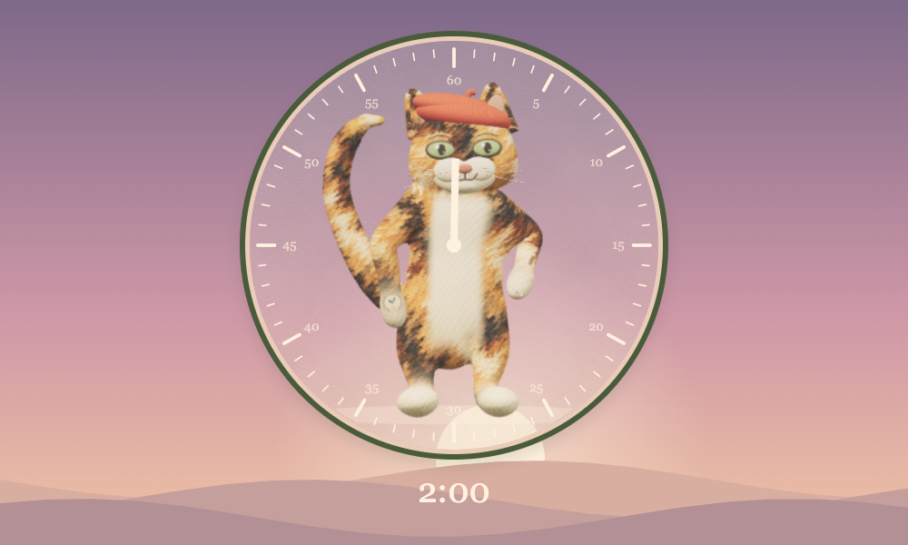

# timer.

**Time to keep track of time.** A quiet classroom countdown timer with painted characters, gentle humor, and three ways to watch the time pass.

### [Open the timer →](https://bennettlandman.github.io/Timer/)

No installation or account is needed. Choose a clock, set a duration, and press **Start timer**.

## Three clocks, a little company

**The painter · Analog**

A cat paints the hands behind frosted glass, occasionally taking a small break to check a watch, stretch, read, or sip tea. In the final minute, it scratches away the seconds counter-clockwise, from 59 to 0. When time is up, the glass breaks to reveal the artist. A gentle ending is also available.

**Mindfulness · Sunrise**

The analog painter takes a quiet movement break while a starry night slowly becomes a warm sunrise. Forty shuffled activities include visible breathing, seated meditation, standing and reclining yoga, and familiar wax-on, wax-off, fence-painting, floor-sanding, house-painting, and jacket exercises. The cat breathes through gentle body and paw movement; there are no activity prompts. The cat erases the last minute’s line and paints zero before settling with paws together in a fixed namaste pose.

**The builders · Digital**

Solid pieces slide into the clock from behind and tumble out as the digits change. A cast of 25 animals occasionally helps clear the floor. At the end, the red-capped cat peeks out from behind the clock.

| The painter | The builders | Mindfulness |
| --- | --- | --- |
|  |  |  |

## Using the timer

1. Choose **The painter**, **The builders**, or **Mindfulness**.
2. Select a 1, 5, 10, 15, or 30 minute preset, or enter your own minutes and seconds.
3. Press **Start timer**. Use **Pause**, **Restart**, or **Cancel** as needed. Add 3 minutes, 5 minutes, or a custom amount without starting over.

In The painter and The builders, the background changes from green to yellow to red as the deadline approaches. Red never lasts more than a minute; yellow lasts twice as long as red. For example, a 10 minute timer turns yellow with 3 minutes left and red with 1 minute left.

Mindfulness follows the full countdown from night through lavender twilight, rose dawn, and golden morning. It keeps its calm sky during the final minute and always closes gently. Short intervals skip activities that cannot finish before painting or the closing pose.

Use **Full screen** for a classroom display. During a timer, **Space** pauses or resumes and **F** toggles full screen when focus is outside a button or input. Buttons also support normal keyboard controls.

Share a [one-minute mindfulness timer](https://bennettlandman.github.io/Timer/?mode=mindfulness&duration=60&start=1) that starts automatically once its artwork has loaded. Download its QR code as a [PNG](docs/qr/mindfulness-1-minute.png) or a [printable SVG](docs/qr/mindfulness-1-minute.svg).

## Sound and motion

Sound starts off. Open **Sound & settings** to enable the end sound, ticking, or soft ambient tones, adjust the volume, or mute everything.

Choose **Gentle ending** to reveal the analog artist without breaking the glass. **Less motion** provides still characters and simpler clock changes; the timer also respects your device’s reduced-motion preference. Settings are saved in the current browser.

## Before classroom use

Use a browser with WebGL 2 enabled and allow the artwork to finish loading before starting. Keep the device awake if an end sound needs to play on time. The countdown catches up when you return from another tab, but a sleeping device can delay sound and screen updates.

Timer has no accounts, advertising, or analytics. The application stores preferences in your browser and sends no timer or student data to an application server. The hosted site loads from GitHub Pages. See [hosting and offline use](HOSTING.md) for self-hosting options and limitations.

## Downloads and documentation

- [Latest release and static-site download](https://github.com/BennettLandman/Timer/releases/latest)
- [Hosting guide](HOSTING.md)
- [Developer guide](docs/DEVELOPMENT.md)
- [Release notes](CHANGELOG.md)
- [Testing and browser coverage](QA.md)
- [Artwork and dependency credits](ASSETS.md)
- [Report a problem or suggest an improvement](https://github.com/BennettLandman/Timer/issues)
