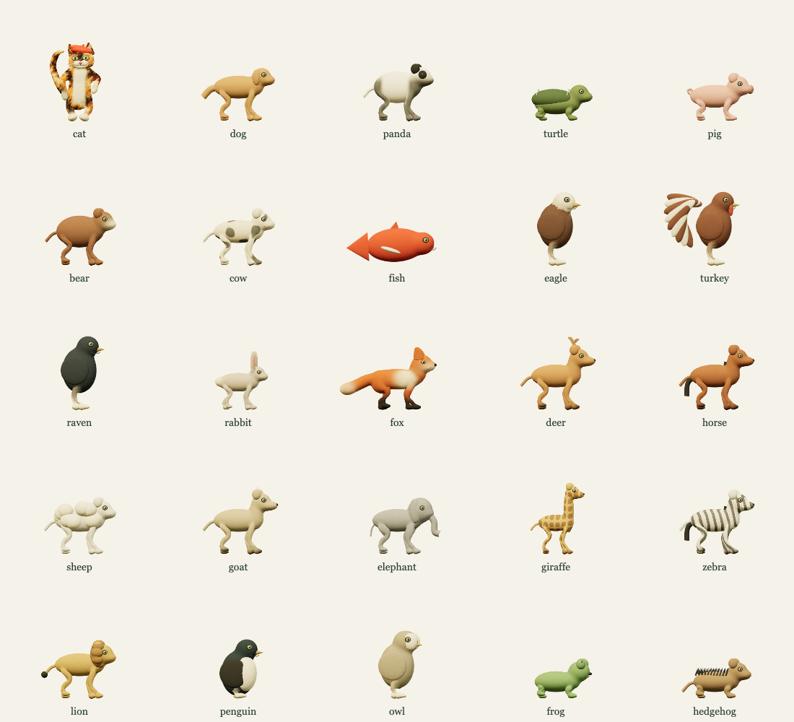

# Artwork and visual development

Timer uses warm cream, ochre, forest green, teal, and vermilion, with painted surfaces and expressive animal characters. The released application renders continuous 3D characters with skeletal motion. Frosted glass and pigment textures give the clocks their surface character.

## Visual references

These paintings and material studies informed the character identities and clock treatments. They are development references; the running clocks are rendered separately so their marks, digits, and motion follow the countdown.

- [Cat and red fish painting](art-review-v2/painted-cat-and-fish.png)
- [Frosted-glass material study](art-review-v2/frosted-glass-clock.png)
- [Digital depth study](art-review-v2/depth-clock.png)
- [Original character sheets](painted-cast/PROMPTS.md)
- [Cat and fox motion-study notes](rig-proof/README.md)

## Historical image-animation experiments

Earlier prototypes used painted raster characters and 24-pose image sequences. Those sequences were replaced by the current 3D models and are excluded from the production build. Old references remain here to document the design process; they do not describe the released animation system.

The [pose-generation record](ANIMATION_PROMPTS.md), [initial character prompts](painted-cast/PROMPTS.md), and [clock-study prompts](art-review-v2/PROMPTS.md) preserve that history. The [asset ledger](../ASSETS.md) identifies the materials that actually ship and the bundled dependency license.
